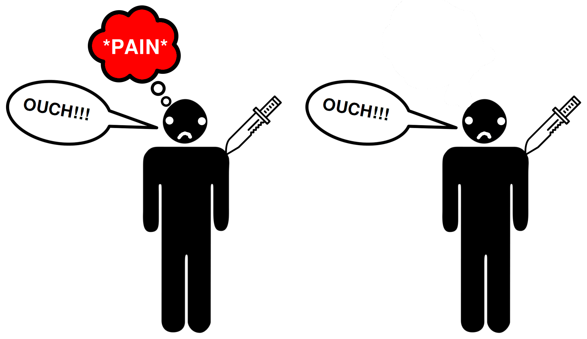

#lead/computationalphilosophy #core/appliedneuroscience #core/artificialintelligence

A **philosophical zombie** (or p-zombie) is a hypothetical being used in a philosophical argument made prominent by David Chalmers in 1996. It is stipulated to be physically and behaviourally identical to a human while entirely lacking conscious experience (qualia). The stipulation is a claim about philosophical conceivability, not an empirical report that such beings exist.

- **Physically identical:** Same neurons, brain states, and bodily processes as a conscious human.
- **Behaviourally indistinguishable:** Responds to stimuli, reports feelings, and acts appropriately—but has **no subjective experience**.
- Key concept: a proposed separation between physical facts and phenomenal facts, used to challenge some forms of **physicalism**.

## Purpose of Zombie Arguments

- **Critique physicalism:** Argue that a complete physical duplicate without experience is conceivable, and that this would put pressure on views identifying phenomenal consciousness with physical facts. Whether conceivability establishes metaphysical possibility is disputed.
- **Explore Mind-Body Problem:** Relationship between brain states and subjective experience.
- **Test Theories of [Consciousness](../books/how_to_build_a_brain/multiple_realisability.md#implications-in-consciousness-research):** Can any theory account for zombies’ apparent absence?

## Criticisms of Zombie Arguments

- **Logical or metaphysical incompatibility:** Physicalists typically deny that a physical duplicate could differ in phenomenal properties; critics therefore reject the zombie description or the inference from conceivability to possibility.
- **Conceivability is not detectability:** By stipulation, a p-zombie has no physical or behavioural difference for an empirical test to detect. This does not show that actual humans or artificial systems can be observationally classified as zombies.
- **Ambiguity of “consciousness”:** Different definitions of phenomenal experience, access, and report can lead to different conclusions.

## Relevance to Applied Neuroscience

- **Consciousness vs. Behaviour:** Studying neural correlates of behaviour vs. experience.
- **Brain-Computer Interfaces:** Can we create artificial consciousness or detect it in others? This question is central to approaches like [Progressive Synthetic Neural Substrate Transfer](psnst.md).
- **Ethical Implications:** If zombies are possible, should we treat them differently?
- **[Naturalisation of phenomenology](../articles/naturalisation_of_phenomenology.md):** Bridging first-person phenomenological methods with third-person neuroscience may offer tools to distinguish genuine consciousness from zombie-like processing.

The zombie argument therefore marks a conceptual limit on what behaviour and physical measurements could establish under its own stipulation. It does not provide evidence that such beings occur, nor does it by itself identify a test for phenomenal consciousness.

See also [fading qualia](../books/from_biological_to_artificial_consciousness/fading_qualia.md), which considers a different thought experiment about experience during gradual substrate replacement.
