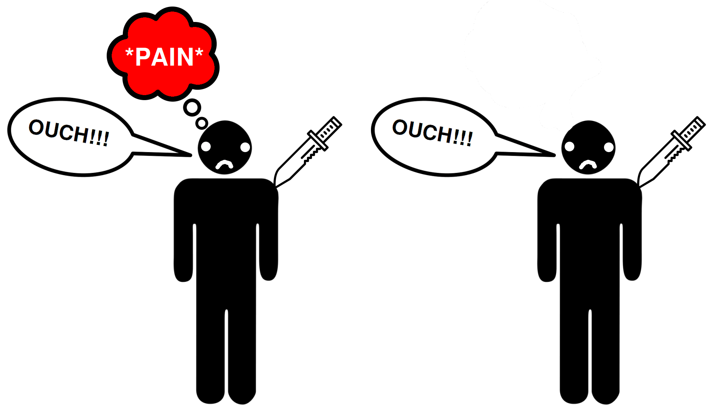

#lead/computationalphilosophy #core/appliedneuroscience #core/artificialintelligence

A **philosophical zombie** (p-zombie) is a hypothetical physical and behavioural duplicate of a conscious person that lacks **phenomenal experience**: it reports pain but feels nothing. This stipulation is not evidence that zombies exist.

## Argument and objections

Chalmers' zombie argument challenges **physicalism**:

1. A world physically identical to ours but without experience is ideally conceivable.
2. Such conceivability entails metaphysical possibility.
3. If such a world is possible, physical facts do not necessitate consciousness; physicalism is false.

The disputed steps are whether the scenario is genuinely conceivable and whether conceivability establishes possibility. Physicalists may deny its coherence, or argue that distinct concepts need not pick out distinct properties.

## Empirical boundary

**Conceivability is not detectability.** A stipulated physical duplicate matches neural measurements and verbal reports; no physical or behavioural test could distinguish it from its conscious counterpart. This does not undermine empirical consciousness research: it constrains what this thought experiment can establish.

[Naturalised phenomenology](../articles/naturalisation_of_phenomenology.md) can relate reported experience to neural processes, not detect zombies as defined. For AI assessment or hypothetical [PSNST](psnst.md), substrates differ rather than being physically identical: inferring experience from functional performance requires explicit theoretical assumptions. [Fading qualia](../books/from_biological_to_artificial_consciousness/fading_qualia.md) examines that inference during gradual substrate replacement.

**Sources:** [Chalmers](https://consc.net/zombies-on-the-web/); [Stanford Encyclopedia of Philosophy, §§2–5](https://plato.stanford.edu/entries/zombies/).
