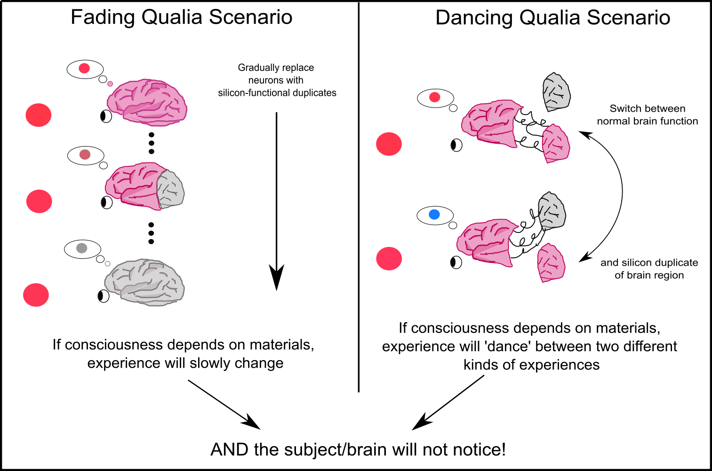

#lead/computationalphilosophy #core/artificialintelligence

Fading qualia is a **thought experiment associated with philosopher [David Chalmers](https://en.wikipedia.org/wiki/David_Chalmers)** and discussed in his 1996 book "[The Conscious Mind](https://www.amazon.com/Conscious-Mind-Search-Fundamental-Philosophy/dp/0195117891)." Chalmers uses it as part of an argument for organisational invariance in consciousness: if functional organisation remained fixed while biological neurons were gradually replaced, would experience depend on the original biological substrate? The thought experiment challenges substrate-specific accounts, but its conclusion depends on controversial assumptions about functional equivalence, gradual replacement, and the relationship between cognition and phenomenal experience.

## The Experiment

1. Start with a conscious human and a hypothetical system with equivalent functional organisation.
2. Gradually replace the human's neurons with artificial components.
3. Hold the relevant functional organisation fixed throughout the process.

The setup is a philosophical model, not a proposed clinical procedure or an established engineering result. “Equivalent” also requires qualification: equivalence at one functional or computational grain need not guarantee equivalence at every physical or biological level.

## Possible Outcomes

1. **Suddenly disappearing qualia:** [Consciousness](../sizing_up_consciousness/levels_of_cognitive_complexity.md#consciousness) vanishes at a specific point.
2. **Fading qualia:** Consciousness gradually fades away.
3. **Unchanged qualia:** Consciousness remains the same.

These are stylised options in the argument rather than an exhaustive set of empirically established outcomes.

## Chalmers' Argument

- Chalmers argues that sudden disappearance is implausible within the gradual-replacement setup, because it would require a sharp transition without an independently motivated boundary.
- He argues that fading qualia would produce implausible consequences, such as:
  - an intermediate being (for example, “Joe”) whose reports and behaviour systematically misrepresent experience;
  - a strong dissociation between cognition and consciousness.
- On this reasoning, Chalmers presents unchanged qualia as the most plausible option among those considered. This is an argumentative conclusion, not a settled result about consciousness.

## Implications

- Used by Chalmers to support the principle of organisational invariance.
- If its assumptions are accepted, it suggests that consciousness need not depend on one specific physical substrate.
- It therefore motivates the possibility of artificial consciousness in non-biological systems, without demonstrating that such systems would be conscious.

## Criticisms and Counterarguments

1. Gradualism trap (Mogensen, 2024)
   - Abrupt changes possible from gradual alterations in complex systems
2. Partial brain argument (Mallah)
   - Consciousness becomes partial, not fading
3. Introspective reliability (Schwitzgebel)
   - Inconsistent trust in introspective judgments across stages
4. Empirical objections (Aides)
   - Questioning application of physical principles to qualia

The experiment differs from a [philosophical zombie](../../_general/philosophical_zombies.md): a zombie is stipulated to lack experience despite matching the relevant physical and behavioural facts, whereas fading qualia describes a possible change in experience during a sequence of substrate replacements.

## Significance

- Influential in philosophy of mind and consciousness studies
- Informs debates on artificial consciousness and mind uploading
- Challenges traditional views on the nature of consciousness

---

> [!info] Dancing qualia (Chalmers, 1996)
>
> - Companion to [Fading qualia](fading_qualia.md); asks whether qualia could change while functional organisation stays fixed.
> - Setup: two functionally isomorphic implementations (e.g., biological brain vs silicon). A switch toggles which realiser runs each part, without altering inputs, outputs, or internal causal structure.
> - If qualia depended on substrate, flipping the switch would make experiences “dance” (dramatically change) while behaviour, reports, and memories remain identical—so the subject could not notice the change.
> - Chalmers argues that this would create an implausible gulf between experience and cognition; on his view, organisational invariance is therefore more plausible: same functional organisation ⇒ same qualia.
> - Implications on this argument: it supports the coherence of artificial consciousness and challenges substrate-essentialism, without settling either claim.
> - Typical objections: hidden implementation-dependent dynamics; limited introspective access; “small” qualia differences. Chalmers’ reply: if differences are in principle cognitively inaccessible, positing them is ad hoc.
