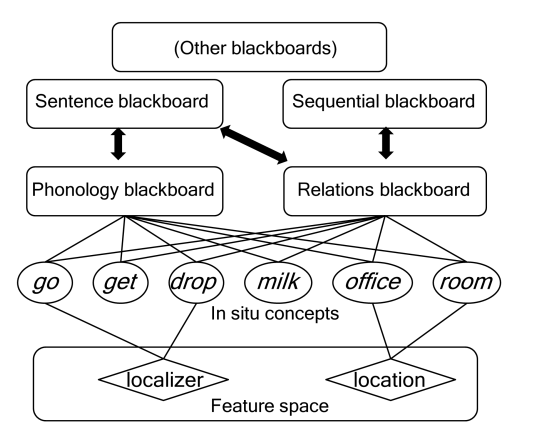

#core/biomimeticneuromorphics #core/appliedneuroscience #core/artificialintelligence

Neural blackboard architectures are a theoretical framework for explaining **how a cognitive system might temporarily make information from different processes available to one another.** A “blackboard” is not necessarily a literal brain structure: it is a shared, revisable representational workspace whose contents can be assembled, modified, and read by multiple specialised processes. The framework is a model of possible organisation, not evidence that the brain contains one anatomically distinct blackboard.

## Key Concepts

1. **Temporary bindings**
    - Form context-dependent associations between representations.
    - Allow a system to combine information without fixing every association permanently.
2. **Structure-preserving mappings**
    - Preserve relevant relationships between elements in a composite representation.
    - Make the framework relevant to structured tasks such as language processing and reasoning.
3. **Working-memory integration**
    - Provides a temporary workspace for information from different sources.
    - Allows representations to be compared, revised, and used together.
4. **Parallel processing**
    - Allows several specialised processes or bindings to operate at once.
    - Requires coordination so that concurrent activity does not produce ambiguous combinations.
5. **Gating and routing**
    - Controls which information is written to, read from, or removed from the workspace.
    - Makes access task-dependent rather than unrestricted.

## Implementation

- A possible implementation would use interacting neural circuits whose activity can be selectively coupled to represent temporary associations.
- The architecture does not specify one unique biological mechanism. Candidate implementations would need to explain how representations are encoded, how bindings are formed and removed, and how information is routed without destroying relevant structure.
- In an artificial system, the same functional organisation could be realised with different representations and connectivity schemes; implementing the framework therefore does not by itself reproduce a biological blackboard.

## Functional and binding relevance

- The architecture makes the binding problem concrete: it asks how features or symbols that are processed separately can be combined into the right temporary object or relation.
- It also illustrates a functionalist style of explanation, because the emphasis is on roles such as storing, routing, binding, and updating information rather than on one material substrate. This does not show that every implementation with those roles is conscious.

## Constraints

- A useful architecture must limit capacity, noise, interference, and the lifetime of temporary bindings.
- It must preserve identity and relational structure while allowing rapid reassignment of bindings.
- Gating and routing introduce control requirements: indiscriminate access could cause interference, whereas excessive restriction could prevent integration.
- The framework does not by itself explain phenomenal consciousness, learning, semantic content, or the biological details of any particular neural circuit.

## Applications

- Language Processing: Explaining how words combine into phrases and sentences
- A bridge between symbolic AI and connectionist approaches, provided the implementation preserves the relevant functional constraints.

## Significance

- Addresses the “binding problem” in neuroscience as an architectural question.
- Offers a framework for more flexible, context-sensitive AI models, while leaving the implementation and empirical adequacy open.
