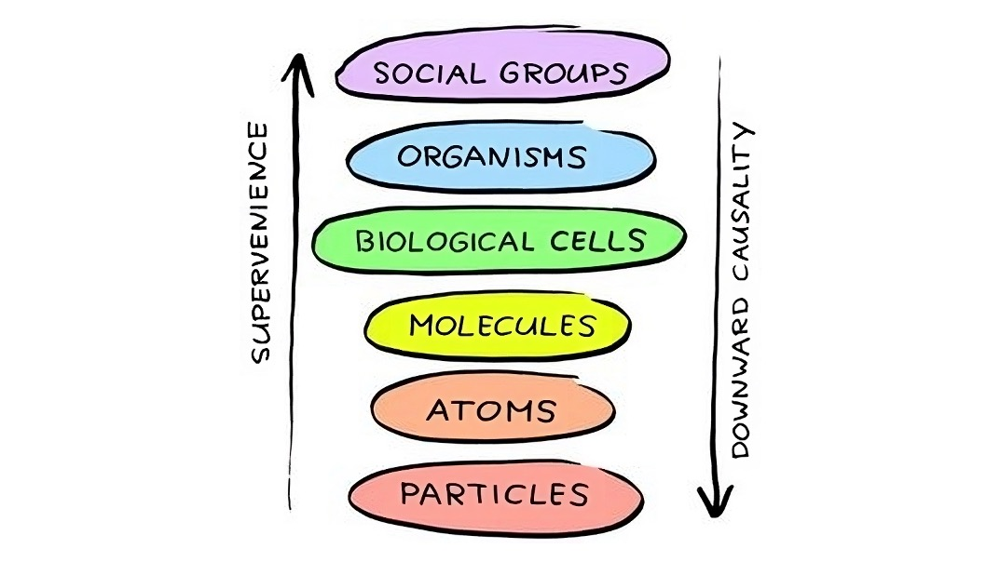

#lead/computationalphilosophy

*The diagram illustrates levels of organisation, but its downward-causality arrow represents an additional claim: supervenience alone does not imply downward causation.*

- **Definition**: A relationship between two sets of properties: there cannot be a difference in the supervenient properties without a difference in the base properties, but not necessarily vice versa. Equivalently, identical base properties guarantee identical supervenient properties within the scope of the claim.
- **Context**: Central in discussions about the mind–body problem, ethics, and the relationship between physical and mental properties. Supervenience constrains how properties can vary together; it does not by itself establish reduction, irreducibility, or a causal mechanism.
- **Example**: If mental states supervene on brain states, experiencing joy cannot change without some change in the physical state of the brain. However, the brain might change in ways that do not alter the experience of joy. This illustrates the thesis rather than establishing that the brain alone is a sufficient base.

> [!example] Example: Supervenience of Mind on Brain  
> Suppose pain supervenes on the brain’s physical state. If you touch a hot stove and feel pain, that mental state cannot change without a corresponding physical change in the brain. An exactly identical brain state could not accompany a different pain experience within the scope of this thesis.
>
> The converse does not follow: a physical difference need not produce a difference in pain. Supervenience also leaves open why this relationship holds.

## Types of Supervenience

### Global Supervenience

- **Definition**: A type of supervenience where the relationship holds across all possible worlds; if two worlds are identical in their base properties, they must also be identical in their supervenient properties.
- **Example**: A global moral-supervenience thesis says that worlds identical in all physical and social facts must also be identical in their moral properties.

### Local Supervenience

- **Definition**: Supervenience that compares individual objects rather than entire worlds. **Weak** individual supervenience compares objects within each possible world; **strong** individual supervenience also compares objects across possible worlds.
- **Example**: For ideal spheres in Euclidean geometry, surface area supervenes on radius: spheres with the same radius cannot differ in surface area.

## Source

- [Stanford Encyclopedia of Philosophy: Supervenience](https://plato.stanford.edu/entries/supervenience/), especially §§3.3, 3.5, 3.7 and 4.1.
