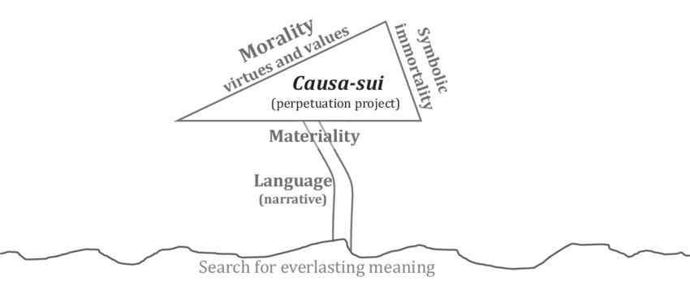

#lead/computationalphilosophy

A causa sui project is the attempt to be **one's own cause**, and the fact that the attempt fails. *Causa sui* means self-caused. A human being is not. Ernest Becker's claim, in *The Denial of Death* (1973), is that much of a life is organised as if one had caused oneself and could therefore outlast one's creaturely end.

The figure calls this a perpetuation project. That names the attempt, not a success. Symbolic immortality and a moral code are what it is built from. Materiality is what it tries to rise above. Narrative is how the story is told. None of this makes the person self-caused.

## Not one idea

- **Spinoza**: *causa sui* is a status, not a project. A substance whose essence involves existence. For him, God alone.
- **Becker**: the phrase names an impossible human project. Culture offers hero-systems — a work, a family, a state, a faith — through which a person tries to earn a significance death cannot cancel. The terror is not removed. It is invested in the project.
- **Sartre**: the desire to be in-itself-for-itself is the desire to be God, a being that would found its own existence. Related, and not Becker's term.

Becker reads Freud's Oedipal and transference projects as early forms of the same refusal. Freud did not use the term.

A lasting work is one costume the project wears. It is not the definition. The work, the institution, or the creed is being asked to do what a creature cannot do.

> [!example]
>
> - A result or a work of art treated as a personal survival.
> - A family, a firm, or a movement meant to carry a name past a death.
> - A faith that promises the self will not end.
