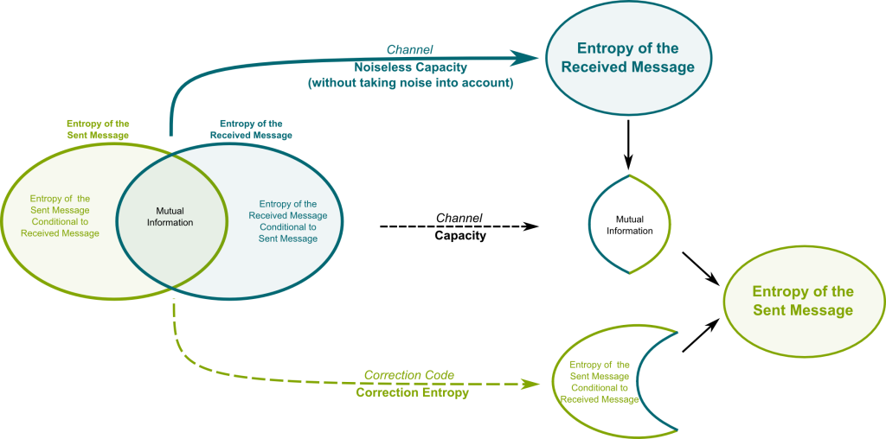

#core/appliedneuroscience #core/softwaredevelopment #core/mathematicalphysics

**Shannon information** quantifies statistical uncertainty and surprise, rather than the meaning or phenomenal character of a message.

1. **Self-information**: An outcome $x$ with probability $p(x)$ has surprise $-\log_2 p(x)$.
2. **Entropy**: Measure of average information content in a message.
   - Formula: H(X) = -Σ p(x) log₂ p(x)
   - Units: bits (when using log₂)
3. **Properties**:
   - Non-negative
   - Additive for independent events
   - Maximal for uniformly distributed events

## Key Principles

1. **Uncertainty Reduction**: Information is gained when uncertainty is reduced.
2. **Probabilistic Nature**: Based on probabilities of events/messages.
3. **Channel Capacity**: Maximum rate of reliable information transmission.

## Information retained by a representation

**Mutual information** $I(X;Y)$ measures statistical dependence; for discrete variables it can be expressed as $H(X)-H(X\mid Y)$. The figure's overlapping regions illustrate this quantity, distinct from the entropy of either variable alone.

If a code $Z$ is generated only from data $X$, the data processing inequality gives $I(Y;Z)\leq I(Y;X)$ for a target $Y$. [Information-preserving abstraction](../../_general/information_preserving_abstraction.md) connects equality to task-relative sufficiency: a compressed representation can retain all information about one target while discarding information needed for another. This provides a precise bridge to [autoencoders](../../videos/autoencoder.md) and coarse-grained models without treating statistical compression as preserved consciousness.

## Relation to [Integrated Information Theory](../../videos/integrated_information_theory.md) (IIT)

1. **Foundation**: Serves as a starting point for IIT’s concept of information.
2. **Contrast**:
   - Shannon: Statistical properties of messages
   - IIT: Causal and intrinsic nature of information in a system
3. **Extension**: IIT introduces “integrated information” (Φ) to capture consciousness-relevant aspects.
4. **Measurement**:
   - Shannon: Bits of transmitted data
   - IIT: Φ (phi) as a measure of integrated information

## Key Differences from IIT’s Perspective

1. **Intrinsicality**: IIT focuses on information intrinsic to a system, not dependent on an external observer.
2. **Integration**: IIT emphasises irreducible information integration, beyond mere information presence.
3. **Causality**: IIT considers the causal structure of information, not just its statistical properties.
4. **Exclusion**: IIT introduces the concept of exclusive, definite causal structure.
