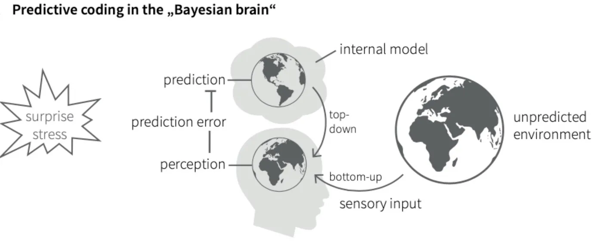

#lead/computationalphilosophy #core/appliedneuroscience #core/artificialintelligence

The Bayesian brain hypothesis proposes that the **brain interprets the world using Bayesian models of uncertain inference.** On this view, neural systems may update estimates in response to sensory information and prior constraints. This is a hypothesis about computational and potentially algorithmic organisation, not an established claim that the brain literally calculates posteriors or uses one uniform implementation. The figure presents a proposed predictive-coding implementation, not proof of a particular neural mechanism.

## Key Concepts

### Probabilistic Inference

- **Predictive coding:** A proposed scheme in which systems predict sensory inputs and use mismatches between predictions and signals to refine their models.
- **Prediction error:** The difference between an expected and an incoming signal. Its role, representation, and weighting are empirical questions rather than consequences of Bayesian terminology alone.

### Bayesian Updating

- Bayesian updating revises beliefs in light of new evidence: a **prior** is an existing belief, a **likelihood** is the evidence given the hypothesis, and a **posterior** is the belief revised by that evidence. See [Bayes' theorem](../books/essential_math_for_data_science/bayes_theorem.md) for the formal statement. This terminology describes the hypothesis at a computational level; it does not imply that neurons implement the formula.

Prediction error may also sit within the body–environment control loop proposed by [distributed adaptive control theory](distributed_adaptive_control_theory.md), but that is a related and distinct hypothesis. A [neural blackboard architecture](../books/how_to_build_a_brain/neural_blackboard_architectures.md) could, in principle, organise information used by predictive processes, but the Bayesian brain hypothesis does not entail a blackboard architecture. Neither agreement with sensory data nor a predictive model establishes phenomenal experience; [phenomenology](../../003_education/kcl/03_mental_health_in_the_community/phenomenology.md) and [consciousness engineering](../_general/consciousness_engineering.md) therefore constrain, rather than confirm, what such a model would preserve. Measures grouped under the [Quantitative Consciousness Index](quantitative_consciousness_index.md) may provide state-related evidence, but they do not by themselves validate Bayesian inference or establish phenomenal consciousness.
