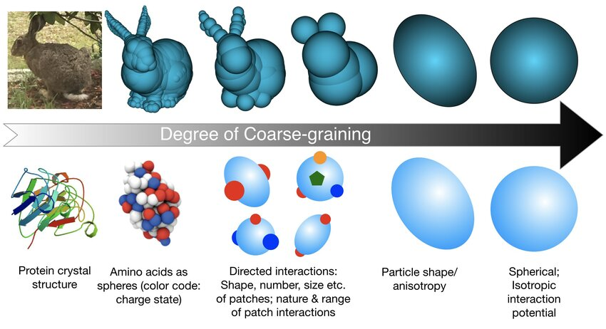

#core/appliedneuroscience #core/mathematicalphysics

Coarse graining is a methodological approach in science, particularly neuroscience, that **simplifies complex systems by reducing details—such as through averaged observations or simplified experimental models—to uncover fundamental principles and dynamics.** This counters the challenges of high-dimensional data from advanced recordings, which can lead to biases, over-interpretation, and errors, as seen in cerebral cortex studies where the brain's vast complexity dwarfs that of simpler organs like the heart.

## Reduction is not equivalence

A formal coarse-graining is often a many-to-one map $q:X\to Z$: detailed states become indistinguishable at the chosen scale. The image illustrates progressive loss of geometric and interaction detail. Which losses are acceptable depends on the question; simplification alone does not guarantee better prediction.

[Dynamical abstraction](../_general/dynamical_abstraction.md) adds the requirement $q\circ T=\bar T\circ q$: evolving then coarse-graining should agree with evolving the reduced model. This can fail if discarded variables influence future macrovariables. [Decoupling of scale](../videos/decoupling_of_scale.md) can support an approximation, but does not automatically establish exact closure.

Experimental simplification, such as isolating tissue or applying a drug, is related but distinct: it changes the physical system rather than merely its description. Extrapolation to the unmodified system therefore needs separate validation. [Information-preserving abstraction](../_general/information_preserving_abstraction.md) provides the complementary test of whether the reduction retains what a particular measurement or inference needs.

## Key Concepts

- **Purpose and Rationale**: Simplifies preparations to highlight core phenomena, akin to studying genetics in yeast or physiology in isolated organs. In brain research, it enables robust analysis amid low signal-to-noise ratios and astronomical [degrees of freedom](degrees_of_freedom_of_the_brain.md).
- **Methods**: Includes pharmacological manipulations (e.g., inducing oscillatory states), anaesthetic states for stable dynamics, or focusing on basic rhythms like EEG alpha waves.
- **Benefits**: Reduces errors in analysis algorithms; facilitates extrapolation from simplified systems to complex ones; complements high-tech tools like multi-channel recordings without attempting exhaustive bottom-up simulations (e.g., Blue Brain project's limitations).
- **Applications**: From spatiotemporal patterns to clinical oscillations and behaviour, coarse graining reveals insights like self-organisation in neural activity.

## Related

- [Degrees of Freedom of the Brain](degrees_of_freedom_of_the_brain.md)
- [Time Scales of the Brain](time_scales_of_the_brain.md)

## Examples from Cerebral Cortex Dynamics

Examples recorded in this note illustrate experimental simplification; without a full source citation here, they should not be treated as independently verified evidence for a formal coarse-graining map:

- **Emergent Spatial Patterns**: Using organotypic slices treated with bicuculline and carbachol to observe stable spiral waves, later seen in vivo epilepsy models (e.g., Mongolian gerbils). Simplifies to study mesoscopic organisation.
- **Human Brain Oscillations**: Analysing posterior basic rhythm (PBR) development in autistic children via EEG—focusing on simple traits like frequency acceleration for clinically relevant findings.
- **Complex Behavior**: Simplifying discrimination learning in animals (e.g., gerbils) by reducing behavioural dimensions, avoiding covert cues and unitary experience complexities.
