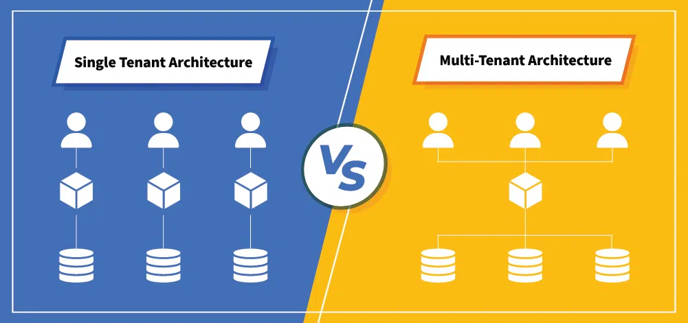

#core/softwaredevelopment

An isolated tenant is an organisation whose **identity, data, and relevant resources are separated from other tenants by deliberate architectural controls.** It is not one standard deployment type, and it does not inherently require dedicated physical hardware. A tenant can be isolated within pooled infrastructure, on dedicated logical resources, or through a mixture of both.

## Deployment Models

- **Silo:** A tenant receives dedicated logical resources or a complete application stack. Physical hosts may still be shared.
- **Pool:** Tenants share resources. The application must enforce tenant-aware authorisation and data partitioning.
- **Bridge:** Only the components with distinct security, performance, or residency requirements are isolated; the rest are pooled.

## Trade-offs

Shared infrastructure improves utilisation and usually lowers cost, but a heavy tenant can become a **noisy neighbour**. Quotas, throttling, monitoring, and capacity partitioning mitigate that risk. Dedicated components can provide stronger performance isolation and meet particular customer or regulatory requirements, but they raise cost and operational complexity.

Isolation is therefore not automatically secure, faster, or compliant. Those outcomes depend on the boundary actually enforced and the controls around it. See the [AWS SaaS Lens](https://docs.aws.amazon.com/wellarchitected/latest/saas-lens/silo-pool-and-bridge-models.html) and [Azure's tenancy models](https://learn.microsoft.com/en-us/azure/architecture/guide/multitenant/considerations/tenancy-models) for the model spectrum.
