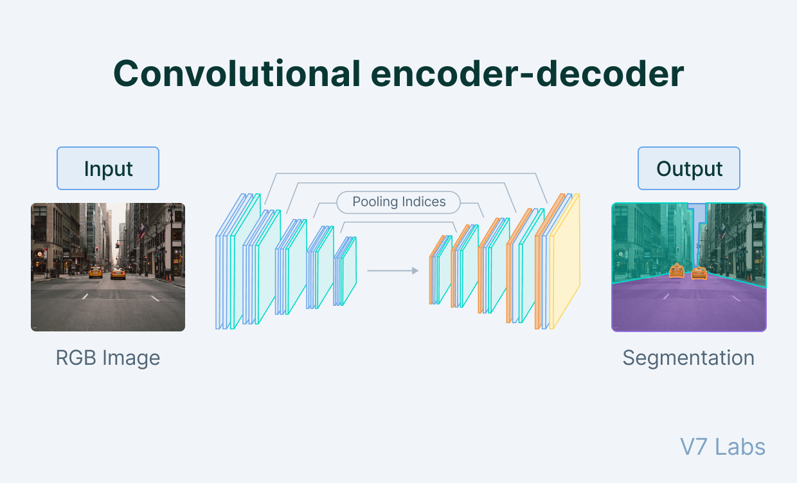

#core/artificialintelligence

The figure predicts segmentation labels, not the original image. It illustrates an encoder–decoder architecture; an autoencoder specifically uses a reconstruction objective.

An autoencoder is a type of artificial neural network used for unsupervised learning. It is primarily **employed in data compression, dimensionality reduction, and feature extraction tasks.** The network consists of an encoder that **transforms the input data into a compressed representation (encoding) and a decoder that reconstructs the original data from the encoded representation.** The objective of an autoencoder is to minimise the reconstruction error, which encourages the network to learn useful features in the encoded representation.

## Architecture

The basic autoencoder consists of:

- **Encoder**: Maps input $x$ to [Latent space](latent_space.md) representation $z$ via $z = f(x)$
- **Bottleneck or constraint**: An undercomplete autoencoder uses fewer latent dimensions; other variants constrain information through sparsity, noise, or regularisation without necessarily reducing dimensionality
- **Decoder**: Reconstructs input from latent representation via $\hat{x} = g(z)$

The network is trained to minimise reconstruction loss $L(x, \hat{x})$, typically mean squared error or cross-entropy.

## Variants

| Type                  | Modification                                    | Use Case                |
| --------------------- | ----------------------------------------------- | ----------------------- |
| **Variational (VAE)** | Learns probability distribution in latent space | Generative modelling    |
| **Denoising**         | Trained to reconstruct from corrupted inputs    | Robust feature learning |
| **Sparse**            | Regularisation enforces sparsity in encoding    | Feature selection       |
| **Contractive**       | Penalises sensitivity to input variations       | Stable representations  |

## Applications

- **Dimensionality reduction**: Alternative to PCA for nonlinear relationships
- **Anomaly detection**: High reconstruction error signals out-of-distribution samples
- **Generative models**: VAEs sample from latent space to generate new data
- **Pretraining**: Learn representations before supervised fine-tuning

## What does reconstruction preserve?

[Information-preserving abstraction](../_general/information_preserving_abstraction.md) distinguishes reconstruction from sufficiency for a downstream task. A low average reconstruction loss can hide the loss of a rare but decisive feature; the training objective determines which errors are penalised.

For temporal data, [dynamical abstraction](../_general/dynamical_abstraction.md) asks a further question: does encoding the next observed state agree with advancing a learned latent model? Reconstruction alone does not enforce this. An encoder–decoder pair is not generally an isomorphism, because decoding need not invert encoding exactly.

See [Dense layers](../books/neural_networks_from_scratch/dense_layers.md) for the building blocks and [Universal approximation theorem](../_general/universal_approximation_theorem.md) for theoretical foundations.
