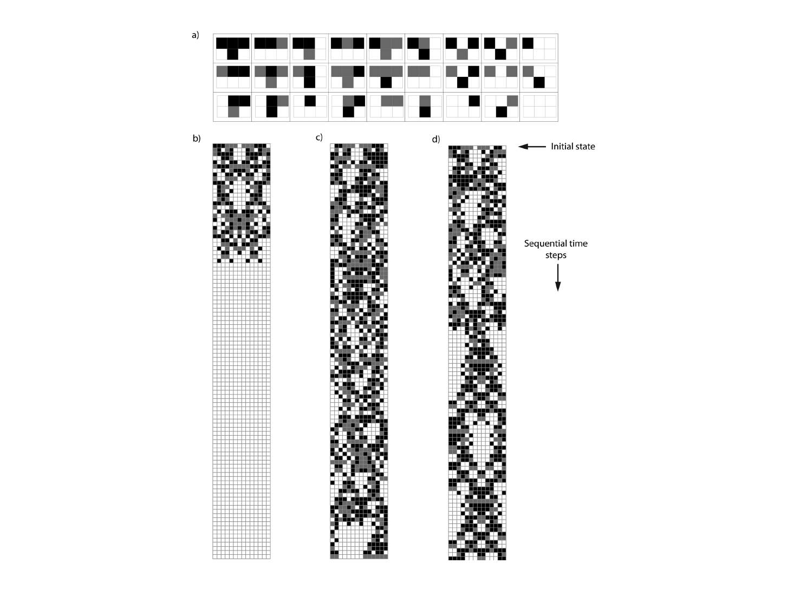

#lead/computationalphilosophy #core/mathematicalphysics

In Wolfram's account, **computational irreducibility** concerns prediction tasks where obtaining a system's later state requires computational effort comparable to evolving it. This concerns possible shortcuts, not merely missing data or failure to find a shortcut.

## Claim and limits

Wolfram argues that irreducibility is widespread. His **Principle of Computational Equivalence** is a broader proposal, not a system-specific proof that prediction cannot be accelerated. A visually complex pattern establishes neither universality nor irreducibility.

Israeli and Goldenfeld show cellular-automaton examples whose [coarse-grained](../papers/coarse_graining.md) observables follow simpler dynamics. Their projections preserve the retained variables' evolution, not all microscopic detail. This qualifies blanket unpredictability claims; it does not refute a properly scoped microscopic claim or guarantee useful reductions everywhere. Wolfram also acknowledges reducible aspects of behaviour.

## Pragmatic use

Specify the system, initial conditions, observable, prediction horizon, precision and computational cost model. Seek reduced predictors and check what they discard; distinguish an unsuccessful search from an impossibility result.

This connects to [decoupling of scale](decoupling_of_scale.md) when ignored detail has controlled effects, but scale separation alone does not establish an efficient predictor.

## Sources

- Wolfram, [*A New Kind of Science*](https://www.wolframscience.com/nks/p739--computational-irreducibility/), pp. 723, 739, 749 — proposal, prediction costs and reducible aspects.
- Israeli & Goldenfeld (2004), [*Computational Irreducibility and the Predictability of Complex Physical Systems*](https://doi.org/10.1103/PhysRevLett.92.074105) — exact coarse-graining and its limits.
