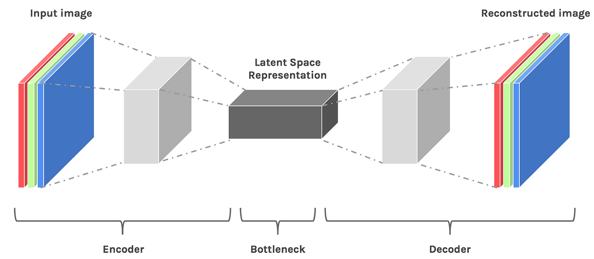

#core/artificialintelligence

**Latent space** is the space of unobserved variables or internal codes used by a model to represent or generate observations. It is common in autoencoders and generative models, but need not be compressed, lower-dimensional, or directly interpretable. This statistical meaning is distinct from latent learning in psychology.

## Roles and mechanisms

- **Purpose:** The goal of mapping data to a latent space is to capture the data's most salient features and underlying patterns. This can significantly simplify the complexity of the data and make further processing or analysis more efficient.
- **Working mechanism:** An inference or encoder model may map observations into latent codes. For instance, an [autoencoder](autoencoder.md) encodes the input and then reconstructs it through a decoder. A generator can instead map sampled latent variables to observations without providing an inverse encoder.
- **Representation learning:** Latent spaces facilitate representation learning, where a model learns to automatically discover the representations needed to classify or predict from raw data. This can lead to more efficient and flexible systems.

## Use cases
   - **Generative Models:** In GANs, the generator generates new data instances by sampling from the latent space.
   - **Dimensionality Reduction:** Undercomplete [autoencoders](autoencoder.md) reduce the dimensionality of input data by mapping it to a smaller latent space.
   - **Recommendation Systems:** Systems can use latent spaces to capture the preferences of users and the characteristics of items.
   - **Image and Text Processing:** Deep learning models often use latent spaces to capture images and text features.

## Adequacy depends on the task

[Information-preserving abstraction](../_general/information_preserving_abstraction.md) asks what a code retains about a specified target. [Dynamical abstraction](../_general/dynamical_abstraction.md) asks whether its evolution supports consistent predictions. Neither property follows from calling a representation “latent”; both need appropriate objectives and validation.
