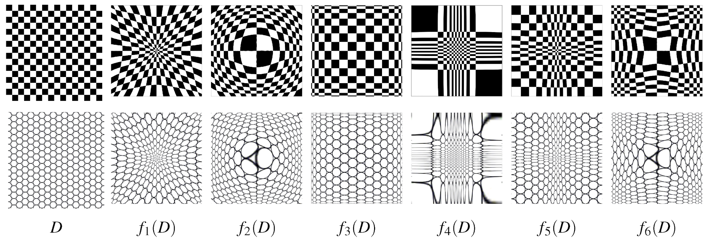

#core/mathematicalphysics

A diffeomorphic transformation is a **special kind of mapping between two differentiable manifolds that is both smooth** (infinitely or sufficiently differentiable) and invertible, with a smooth inverse. In essence, it is a way to smoothly deform one geometric space into another without any tearing, gluing, or introducing sharp edges, and you can always reverse the transformation just as smoothly.

## Key Properties

- **Bijective**: Every point in the source manifold maps to a unique point in the target manifold, and vice versa.
- **Smoothness**: Both the transformation and its inverse are differentiable (often infinitely, but at least to the required degree).
- **Manifold Structure**: The transformation operates between differentiable manifolds (spaces that locally resemble Euclidean space).

## Why Are Diffeomorphic Transformations Important?

- **Preserve Structure**: They maintain the differentiable structure of the manifolds, which is crucial in mathematics, physics, and engineering.
- **Stricter than Homeomorphisms**: While homeomorphisms only require continuity, diffeomorphisms require differentiability, making them more restrictive and powerful.
- **Applications**: Common in fields like differential geometry, image registration, robotics, and theoretical physics.

> [!tip] Visual Analogy
> Imagine a rubber sheet that you can stretch, bend, or twist smoothly into a new shape, but you never tear it or glue parts together. If you can always return it to its original form just as smoothly, the process is diffeomorphic.

> [!example]
>
> - **Valid**: Rotating or smoothly stretching a 2D plane.
> - **Not Valid**: A fold that identifies distinct points, tearing, or creating non-smooth creases. A smooth bend of a sheet into three-dimensional space can still be a diffeomorphism onto its image.

## Geometry versus dynamics

Diffeomorphic manifolds have the same intrinsic dimension. A diffeomorphism need not preserve distances, volumes, or the evolution rule of a system defined on the manifold.

For flows $\Phi_t$ and $\Psi_t$, a diffeomorphism $f$ gives a **smooth dynamical conjugacy** only if $f\circ\Phi_t=\Psi_t\circ f$ for the times being compared. [Dynamical abstraction](../../001_private/_general/dynamical_abstraction.md) distinguishes this invertible case from many-to-one reduction. [Invariant brain emulation](invariant_brain_emulation.md) requires explicit dynamical and observational conditions; smoothness alone cannot supply them.
