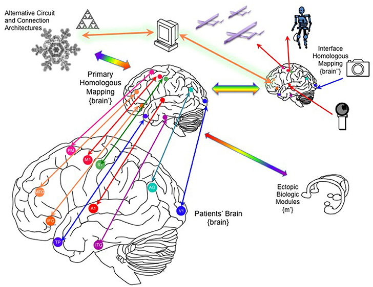

#core/biomimeticneuromorphics #core/appliedneuroscience #core/mathematicalphysics

**Invariant brain emulation** is a proposed engineering criterion for an alternative physical substrate to preserve specified dynamics and observables of a reference brain. It is a modelling and validation target, not an established procedure or a mathematical guarantee of preserved consciousness or personal identity.

## Specify what is preserved

Let $B$ and $S$ be modelled state spaces of a reference brain and an alternative substrate. A candidate state correspondence is $f:B\to S$. For each selected measurement, define separate readouts $O_B:B\to Y$ and $O_S:S\to Y$ into a common outcome space. Observational agreement requires

$$
O_S\circ f=O_B.
$$

Readouts may concern task performance, reports, or physiological variables. The measurement protocol and correspondence between outcomes must be specified. Personal identity and phenomenal experience are not directly available as ordinary readout functions merely because they are preservation goals.

Real experiments usually test approximate agreement over a restricted domain, with explicit tolerances. They do not establish equality for every state or every possible observable.

## Dynamics require more than a smooth mapping

For reference evolution $\Phi_t$ and substrate evolution $\Psi_t$, exact time-preserving correspondence requires

$$
f\circ\Phi_t=\Psi_t\circ f.
$$

This is the commuting-diagram criterion developed in [dynamical abstraction](../../001_private/_general/dynamical_abstraction.md). Together with readout agreement, it implies matching measured trajectories. For differentiable readouts and trajectories, agreement of their time derivatives follows; derivative agreement alone is not a complete preservation criterion.

A [diffeomorphic transformation](diffeomorphic_transformation.md) preserves smooth structure but does **not** by itself preserve dynamics. Smooth conjugacy additionally requires the evolution equation above. Diffeomorphic state manifolds must have the same intrinsic dimension, even if embedded in ambient spaces of different dimensions. Many-to-one reductions require a weaker notion, such as semiconjugacy, rather than a diffeomorphism.

Because brains are [open dynamical systems](../../001_private/videos/open_dynamic_system.md), the comparison must also specify corresponding inputs, outputs, environmental coupling, and perturbations. Matching one spontaneous trajectory is weaker than matching responses across the intended operating regime.

## Distinguish the strengths of the claim

| Claim | Requirement | What it does not establish |
|---|---|---|
| Observational agreement | Selected readouts agree under specified conditions | Complete internal state correspondence |
| Dynamical reduction | A possibly many-to-one mapping respects evolution | Recoverability of discarded distinctions |
| Dynamical conjugacy | An invertible structure-preserving map respects evolution | All physical or intervention-level causal properties unless these are included in the model |
| Consciousness or identity preservation | An adequate account of which physical and causal properties suffice, plus evidence of their preservation | Cannot be inferred solely from the preceding mathematical conditions |

“Functional isomorphism” must therefore specify its state variables, transitions, and intervention structure. It is not established merely by fitting an input–output relation. [Multiple realisability](../../001_private/books/how_to_build_a_brain/multiple_realisability.md) motivates asking whether different physical systems could satisfy the relevant criteria; it does not prove that a particular mapping exists.

## Engineering questions

- **Granularity:** which molecular, cellular, circuit, or system-level distinctions affect the selected outcomes? [Information-preserving abstraction](../../001_private/_general/information_preserving_abstraction.md) clarifies why adequacy depends on the question.
- **Physical implementation:** can the substrate realise the required timing, interactions, and responses? A mathematical simulation alone does not demonstrate this, but neither does its use of conventional computing automatically rule it out. The implementation must be assessed against the stated criteria.
- **Composition:** does a replacement remain adequate when coupled to surrounding tissue? [Compositional modelling](../../001_private/_general/compositional_modelling.md) explains why isolated matching does not guarantee closed-loop success.
- **Validation:** how do errors accumulate over time, across repeated replacements, and under previously untested inputs?

[Biomimetic neuromorphics](biomimetic_neuromorphics.md) explores candidate substrates. [ECP/PSNST](../../001_private/_general/psnst.md) and [Moravec transfer](../../001_private/social/twitter/moravec_transfer.md) motivate different proposed replacement architectures. Neither architecture has demonstrated preservation of the full set of properties at issue merely by being described in invariance language.

> [!warning] Open question
> Preserving selected functional organisation, preserving phenomenal experience, and preserving a person's identity are distinct claims. The [Yoneda critique](../../001_private/videos/yoneda_lemma_and_the_inverted_spectrum_problem.md) gives a parallel warning: mathematical structure cannot establish properties that its definitions do not capture.

## Sources and status

- [Topological conjugacy](https://en.wikipedia.org/wiki/Topological_conjugacy), definitions and flows — the mathematical preservation criterion used here.
- This note applies that criterion as a proposed engineering framework. The mathematics does not establish its biological feasibility or settle consciousness and identity claims. See [structure-preserving connections](../../001_private/_general/structure_preserving_connections.md).
