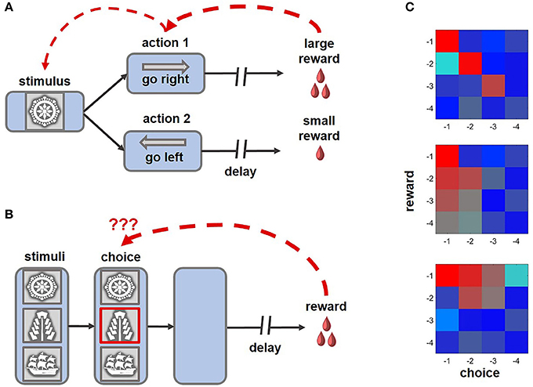

#core/appliedneuroscience #core/artificialintelligence

The credit assignment problem is a fundamental challenge in various fields, including artificial intelligence and neuroscience. It involves **identifying which actions, decisions, or components are responsible for a particular outcome, whether success or failure.** This problem is crucial for optimising learning processes and improving decision-making systems.

## In Artificial Intelligence and Machine Learning

- **Definition**: In AI and machine learning, especially in reinforcement learning, the credit assignment problem concerns identifying which actions an agent takes are responsible for observed outcomes, such as rewards or penalties.
- **Importance**: Solving this problem is essential for effectively training models and agents to make better decisions over time.
- **Challenges**: Actions may have delayed effects, making it difficult to link outcomes with preceding actions directly. The problem involves attributing the correct amount of credit or blame to each action.
- **Solutions**: Various algorithms and techniques, including reinforcement learning strategies, are employed to estimate the value of actions based on their contributions to the overall goal.

## In Neuroscience

- **Definition**: In neuroscience, the credit assignment problem refers to understanding how the brain determines which neurons and synaptic connections contribute to specific behaviours or learning outcomes.
- **Importance**: Addressing this problem is key to comprehending how brain learning, memory formation, and [synaptic plasticity](../kcl/04_biological_foundations_of_mental_health/synaptic_plasticity.md) occur.
- **Challenges**: The brain’s complex network of neurons and the delayed relationship between actions and their outcomes complicate credit attribution to specific neural activities.
- **Solutions**: Theories like dopamine-based reward prediction error signalling hypothesise mechanisms the brain might use to solve the credit assignment problem. [Dopamine](../kcl/04_biological_foundations_of_mental_health/hedonic_system.md#role-of-dopamine) neurons signal the difference between expected and actual rewards, guiding the adjustment of synaptic strengths.

---

## Key Concepts

- **[Synaptic](../kcl/04_biological_foundations_of_mental_health/synaptic_plasticity.md) Plasticity:** The ability of synapses to strengthen or weaken over time, based on their activity levels. This is fundamental to learning and memory in the brain.
- **Reward Prediction Error**: A hypothesis in neuroscience that dopamine neurons signal the difference between expected and received rewards, providing feedback that helps the brain learn from experiences.
- **[Operant](../kcl/02_psychological_foundations/operant_learning.md) Conditioning:** A learning process through which the strength of a behaviour is modified by reinforcement or punishment.

## Error signals versus allocation of updates

A reward prediction error indicates that an outcome differs from expectation; it does not, by itself, identify every action, neuron, or synapse that should change. Temporal credit assignment concerns earlier events, while structural credit assignment concerns components contributing to the result. The figure illustrates the additional ambiguity introduced by delays and competing choices.

[Inference, learning, and control](../../001_private/_general/inference_learning_and_control.md) locates credit assignment within adaptation, distinct from estimating the current state or executing a fixed policy. [Distributed adaptive control](../../001_private/papers/distributed_adaptive_control_theory.md) offers a related architecture in which perceptual learning, value, and action interact; a shared error-correction motif does not establish identical learning mechanisms.
