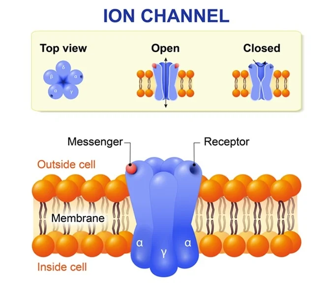

#core/appliedneuroscience #core/mathematicalphysics

**Ion channels** are membrane pores that selectively conduct ions down their electrochemical gradients. **Gating** controls whether a pore conducts; **selectivity** determines which ions can pass. Active transport maintains the gradients driving this passive flow.

## Conductance and driving force

An **ohmic approximation** relates a channel's current to its conductance and driving force:

$$
I=g(V_m-E_{\mathrm{rev}}).
$$

Here $V_m$ is inside-minus-outside voltage, $E_{\mathrm{rev}}$ is the open channel's zero-net-current potential, and positive current means outward positive charge. Conductance $g$ changes with gating; the approximation need not hold across all voltages. Other currents also contribute to the membrane response.

## Neural effect

Opening $\mathrm{GABA}_A$ receptors can depolarise yet still inhibit by lowering membrane resistance and shunting coincident excitatory input. **Depolarisation** describes a voltage change; **excitation** means increased spike probability. Timing, location and other conductances matter.

**Pragmatic use:** identify conductance, reversal potential and cell state before labelling an effect excitatory or inhibitory. These currents generate [graded potentials](../04_biological_foundations_of_mental_health/graded_potential.md) and can participate in feedback supporting [bistability](../../../001_private/books/sizing_up_consciousness/bistability_in_cortical_neurons.md).

## Sources

- *Neuroscience Online*, [*Ionic Mechanisms and Action Potentials*](https://nba.uth.tmc.edu/neuroscience/s1/chapter02.html), §§2.1–2.7 — conductance, selectivity and gradient maintenance.
- Kilb (2021), [*When Are Depolarizing GABAergic Responses Excitatory?*](https://pmc.ncbi.nlm.nih.gov/articles/PMC8651619/) — driving force, shunting and context-dependent GABA effects.
