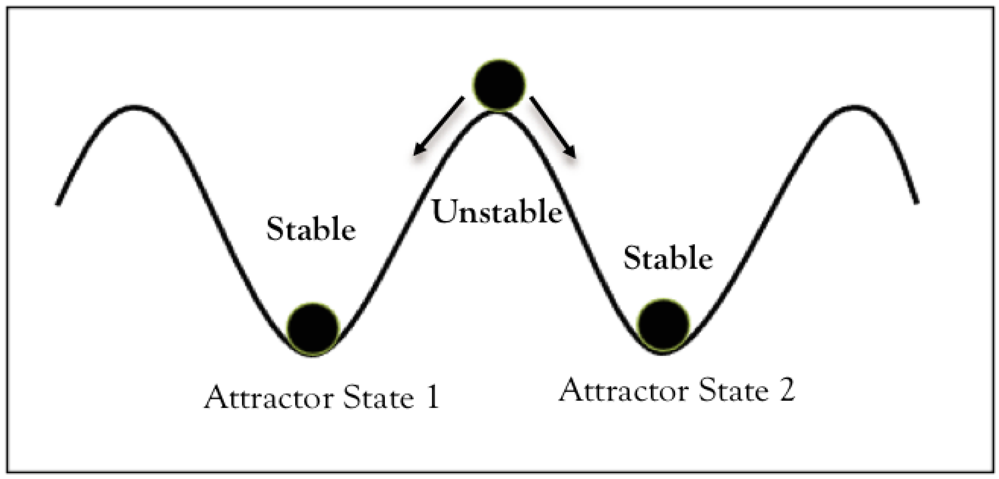

#core/appliedneuroscience #core/artificialintelligence #core/mathematicalphysics

An **attractor** is an invariant set in [phase space](phase_space_and_phasing_rotator.md) approached by trajectories from a set of initial conditions: its **basin of attraction**. The basin need not cover the entire state space.

Attraction does not necessarily mean rest: fixed points, periodic orbits and chaotic sets can all be attractors. Neither chaos nor criticality is required.

## Associative memory

In a **Hopfield network**, recurrent updates can reconstruct a stored pattern from a partial or corrupted cue. Retrieval succeeds when the dynamics reach the intended memory; other memories or **spurious stable states** can capture it instead. Closeness to a pattern alone is not a guarantee.

For the classical binary model, symmetric weights, no self-connections, fixed thresholds and one-neuron-at-a-time threshold updates make energy non-increasing. This guarantees neither the intended memory nor a global energy minimum.

## Practical use

Test recovery after perturbations under specified input and update conditions, using multiple starting states. A stable-looking neural trace alone does not establish an attractor.

[Bistability in cortical neurons](../../../001_private/books/sizing_up_consciousness/bistability_in_cortical_neurons.md) applies the coexisting-states picture to cellular dynamics. The illustration shows two fixed-point attractors, not every possible attractor geometry.

## Sources

- Milnor, [*Attractor*](http://www.scholarpedia.org/article/Attractor), *Scholarpedia* — definitions, basins and periodic attractors.
- Hopfield (1982), [*Neural networks and physical systems with emergent collective computational abilities*](https://www.its.caltech.edu/~jkenny/nb250c/papers/Hopfield-1982.pdf), pp. 2554–2557 — associative recall, energy descent and unintended stable states.
