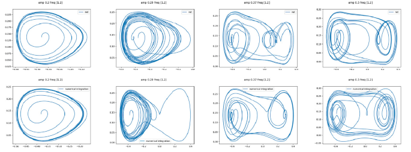
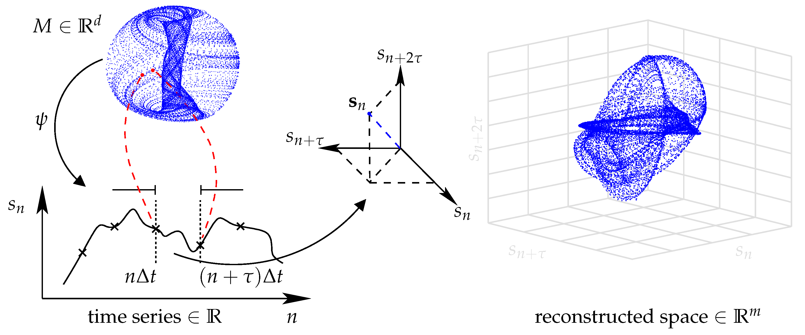

#core/appliedneuroscience #core/artificialintelligence #core/mathematicalphysics

**Phase space** describes the possible states of a dynamical system. **Delay-coordinate reconstruction** builds state-space coordinates from a recorded time series; **phase rotation** changes an oscillatory signal's phase. These are distinct concepts despite their overlapping terminology.

## Phase Space

A **state vector** contains enough information to determine future evolution within a deterministic model. Its evolution traces a **trajectory** through phase space. Fixed points, periodic orbits and [attractors](attractor_state.md) describe different aspects of this geometry.[^reconstruction]

The word *phase* here refers to the system's state, not specifically to an angle within an oscillation.

## Delay-Coordinate Reconstruction

*The diagram illustrates reconstruction from time-separated observations, not phase rotation.*

From a sampled signal $s_n$, construct vectors

$$
\mathbf{y}_n = \left(s_n, s_{n+\tau}, \ldots, s_{n+(m-1)\tau}\right),
$$

where $\tau$ is the delay in samples and $m$ is the embedding dimension.

**Takens' embedding theorem** establishes that, under smooth deterministic-system assumptions, a generic scalar observation and suitable sampling can yield an embedding of the original state manifold using sufficiently many delay coordinates. This recovers a representation of the dynamics, not the original physical variables. Noise, limited observations and differing time scales can undermine practical reconstruction; a plotted neural trajectory alone does not establish an attractor or deterministic chaos.[^reconstruction]

## Phase Rotation and Neural Coupling

For an oscillatory component represented as $z(t)=A(t)e^{i\phi(t)}$, a constant **phase rotation** gives $z'(t)=e^{i\theta}z(t)$. This changes phase while preserving the amplitude envelope $A(t)$; it does not reconstruct state space.

Phase-based analysis complements [spectral analysis of EEG](../06_neuroimaging_in_mental_health/spectral_analysis_in_eeg.md), but asks different questions:

- **Phase-locking value (PLV)** measures the consistency of phase differences between two signals across time or trials. A constant phase offset changes their preferred phase difference, not the PLV magnitude.[^plv]
- **Phase–amplitude coupling (PAC)** describes statistical dependence between a lower-frequency phase and a higher-frequency amplitude envelope—for example, theta phase and high-gamma amplitude in human cortical recordings.[^pac]

Phase rotation does not inherently improve either measure. Neither association alone establishes causal interaction; for example, a common source can produce apparent phase locking between recording channels.[^plv]

## Connection to AI

Reconstruction connects neural time-series analysis with AI's [latent representations](../../../001_private/videos/latent_space.md): both use observations to represent otherwise hidden structure. Delay coordinates are explicitly time-separated measurements, whereas learned latent coordinates depend on an optimisation objective. Takens' guarantee does not automatically apply to a learned representation.

## Sources

[^reconstruction]: Sauer, T. D. (2006). [Attractor reconstruction](http://www.scholarpedia.org/article/Attractor_reconstruction). *Scholarpedia*, 1(10):1727. DOI: 10.4249/scholarpedia.1727.
[^plv]: Aydore, S., Pantazis, D. & Leahy, R. M. (2013). [A Note on the Phase Locking Value and its Properties](https://pmc.ncbi.nlm.nih.gov/articles/PMC3674231/). *NeuroImage*, 74:231–244. DOI: 10.1016/j.neuroimage.2013.02.008.
[^pac]: Canolty, R. T. et al. (2006). [High Gamma Power Is Phase-Locked to Theta Oscillations in Human Neocortex](https://pmc.ncbi.nlm.nih.gov/articles/PMC2628289/). *Science*, 313(5793):1626–1628. DOI: 10.1126/science.1128115.

*The original sources of the two illustrations are unverified; the references above support the text, not attribution of the images.*
